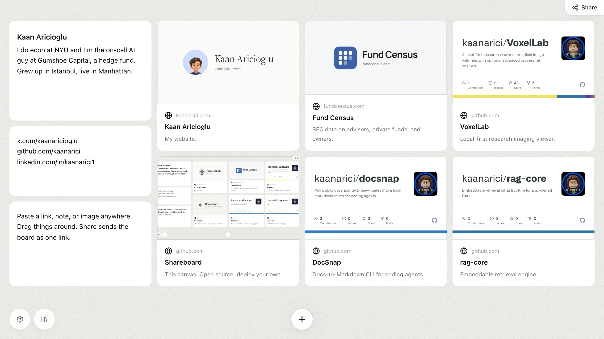

<p align="center">
  
</p>

<h1 align="center">Shareboard</h1>

<p align="center">
  A canvas for links, notes, and images.<br>
  Paste things in, drag them around, and share the board as one link.
</p>

<p align="center">
  <a href="https://shareboard.kaan-aricioglu.workers.dev/"><b>Try the demo</b></a>
  ·
  <a href="#deploy">Deploy your own</a>
  ·
  <a href="LICENSE">MIT</a>
</p>

<p align="center">
  
</p>

Self-host it on Cloudflare: published boards live in your own R2 bucket, drafts stay in your browser, and you sign in with a passkey. No accounts.

## Features

- **Links** become cards with title, description, and image. X posts and YouTube videos embed.
- **Notes** are rich text. **Images** are downscaled in the browser before upload. Small **JSON** files render as cards.
- Cards drag and resize on a grid that packs itself. Up to 12 pages of 60 items per board.
- Install it as a PWA to send things from the OS share sheet, or use the bookmarklet in Settings.

## Sharing

- **Link.** Boards without images are compressed into the URL (`/s#b=...`). Nothing is stored. Anyone can do this.
- **Published.** Boards with images are stored in R2 and open at `/c/:id`. Owner only.
- **Locked.** Published, but encrypted in the browser with a 6-digit PIN. Unlocks are capped at 10 wrong guesses per board per hour.

Each deployment has one owner. You claim it with a setup code, which registers a passkey. Add devices from Settings with a one-time QR link. If you lose every device, claiming again with the setup code removes all old passkeys.

## Run locally

```bash
bun install
bun run dev
```

Open http://localhost:3000. Local R2 runs in Miniflare under `.wrangler/state`. The dev setup code is `shareboard`. For demo mode, put `SHAREBOARD_SETUP_CODE=` in `.dev.vars`.

## Deploy

```bash
bunx wrangler r2 bucket create shareboard
bunx wrangler secret put SHAREBOARD_SETUP_CODE
bunx wrangler secret put SHAREBOARD_LOCKED_STORAGE_SECRET
bun run deploy:cloudflare
```

Open your `workers.dev` address and claim it with the setup code.

- `SHAREBOARD_SETUP_CODE` is the master key: whoever has it can claim the site. Make it long.
- `SHAREBOARD_LOCKED_STORAGE_SECRET` must stay stable, or existing locked boards become unreachable.
- Passkeys belong to one address. After moving to a custom domain, claim again there.

Expire temporary records after a day, and never expire `_shareboard/owner/`:

```bash
for p in handoff intake _shareboard/unlock _shareboard/owner/challenges _shareboard/owner/pairing; do
  bunx wrangler r2 bucket lifecycle add shareboard expire-${p//\//-}-1d $p/ --expire-days 1 --force
done
```

**Demo mode.** Deploy without `SHAREBOARD_SETUP_CODE` and nobody can store anything. First-time visitors get the board in `src/lib/demo-board.ts`, which they can edit and share as a link.

## How it works

- **Drafts** autosave to IndexedDB, including image files.
- **Published boards** are a JSON manifest at `canvases/{id}.json` plus images at `images/{id}/…`. Replacing a board uses R2 conditional writes, so concurrent edits can't corrupt it and stale images are removed only after the new manifest commits.
- **Locked boards** are ciphertext at `locked/…`, keyed by a hash of the server secret and board id, and only served after the PIN checks out.
- **Owner sessions** are stored as SHA-256 hashes in `_shareboard/owner/account.json`. Cookies are `HttpOnly; Secure; SameSite=Strict`.
- **Uploads** must be PNG, JPEG, GIF, WebP, or AVIF, checked by file signature. Stored objects are served with `default-src 'none'; sandbox`.
- **Link previews** are fetched server-side by `/api/og`, which blocks private addresses and re-checks every redirect.
- **Rate limits** are Cloudflare bindings in `wrangler.jsonc`, mirrored in `src/lib/server/rate-limit.ts`.

## Contributing

Run `bun test`, `bun run cf-typegen`, `bun run build`, `bun run typecheck`, and `bun run lint` before opening a PR. CI runs the same. Lint bans type assertions, non-null assertions, and comments. Never commit account IDs, tokens, or bucket endpoints.

Built with TanStack Start, React 19, Tailwind v4, TipTap, and react-grid-layout on Cloudflare Workers and R2.

## License

[MIT](LICENSE)
